<a href="https://ry-ops.dev"></a>

  
  
  

I build the plumbing that lets AI run real infrastructure: **MCP servers** that give Claude hands on Proxmox, UniFi, Kubernetes, Cloudflare and more; **agent frameworks** for security and GitHub ops; and **ESP32 firmware** for the M5Stack gear on my desk. Everything starts in a homelab in Superior, Wisconsin.


## 🔌 The MCP fleet

Each of these is a Model Context Protocol server: plug it into Claude and the platform becomes something you can just *talk to*.


## 🛠️ Featured builds

<a href="https://github.com/ry-ops/proxmox-mcp-server">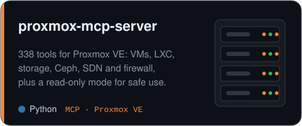</a> <a href="https://github.com/ry-ops/unifi-mcp-server">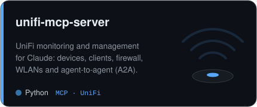</a>
<a href="https://github.com/ry-ops/mr-robot"></a> <a href="https://github.com/ry-ops/git-steer"></a>
<a href="https://github.com/ry-ops/k3s-mcp-server">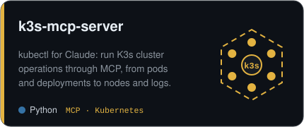</a> <a href="https://github.com/ry-ops/aiana">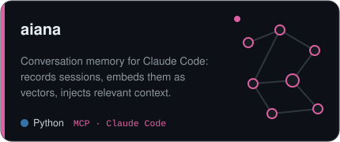</a>
<a href="https://github.com/ry-ops/stackforge"></a> <a href="https://github.com/ry-ops/DriveIQ">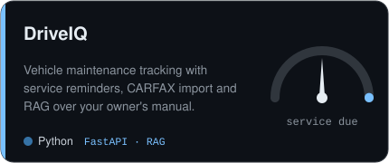</a>

## 🔬 Hardware lab

ESP32 firmware for M5Stack devices lives in its own org, **[m5stack-lab](https://github.com/m5stack-lab)**.

<a href="https://github.com/m5stack-lab"></a>

- **[cardputer-adv-mirror](https://github.com/m5stack-lab/cardputer-adv-mirror)**: mirror a Cardputer ADV display in any browser over WiFi
- **[tab5-mirror](https://github.com/m5stack-lab/tab5-mirror)**: the same for the Tab5, plus remote control
- **[Liner](https://github.com/m5stack-lab/Liner)**: now-playing e-paper display for Volumio
- **[doomagotchi](https://github.com/m5stack-lab/doomagotchi)**: self-playing DOOM where live RF becomes demons

## ✍️ Latest from the blog

<!-- BLOG:START -->
- [Cairn: A Pocket Notebook for Your Mac, Now Open Source](https://ry-ops.dev/posts/2026-11-17-cairn-a-pocket-notebook-for-your-mac-now-open-source/) · Nov 17, 2026
- [Receipts: How Cairn Was Built, and What Backs the Post](https://ry-ops.dev/posts/2026-11-17-receipts-cairn-behind-the-scenes/) · Nov 17, 2026
- [DriveIQ 2.0: Your Own Vehicle Assistant, One Button Away](https://ry-ops.dev/posts/2026-11-14-driveiq-2-0-your-own-vehicle-assistant-one-button-away/) · Nov 14, 2026
- [Moving DriveIQ's Search from Qdrant to Cloudflare Vectorize](https://ry-ops.dev/posts/2026-11-14-moving-driveiq-search-from-qdrant-to-cloudflare-vectorize/) · Nov 14, 2026
- [Receipts: DriveIQ's Move to Vectorize, Behind the Scenes](https://ry-ops.dev/posts/2026-11-14-receipts-driveiq-vectorize-behind-the-scenes/) · Nov 14, 2026
<!-- BLOG:END -->

More at **[ry-ops.dev](https://ry-ops.dev)**.

## 🗂️ Everything else

<b>Every public repo, grouped</b> (refreshed weekly)

<!-- INVENTORY:START -->
**🔌 MCP servers**

| Repo | What it is | ★ |
|---|---|--:|
| [proxmox-mcp-server](https://github.com/ry-ops/proxmox-mcp-server) | MCP server for managing Proxmox Virtual Environment VMs, containers, storage, and cluster resources | 110 |
| [unifi-mcp-server](https://github.com/ry-ops/unifi-mcp-server) | MCP server for the full UniFi Network API, cloud-only through unifi.ui.com (fork) | 15 |
| [k3s-mcp-server](https://github.com/ry-ops/k3s-mcp-server) | MCP server for K3s: tools for workloads, troubleshooting, rollouts and server-side apply, scoped by your kubeconfig's RBAC | 5 |
| [starlink-enterprise-mcp-server](https://github.com/ry-ops/starlink-enterprise-mcp-server) | MCP server for managing Starlink terminal fleet through the Starlink Enterprise API | 3 |
| [cloudflare-mcp-server](https://github.com/ry-ops/cloudflare-mcp-server) | Cloudflare MCP Server | 2 |
| [aiana](https://github.com/ry-ops/aiana) | AI conversation attendant for Claude Code - monitors and records conversations in real-time via Claude Code API | 1 |
| [eagle-scout](https://github.com/ry-ops/eagle-scout) | MCP server for Docker Scout - container security scanning | 1 |

**🔬 Hardware · m5stack-lab**

| Repo | What it is | ★ |
|---|---|--:|
| [m5stack-lab/sferic-sticks3](https://github.com/m5stack-lab/sferic-sticks3) | MIT-licensed ESP32-S3 hardware/radio multitool firmware for the M5Stack StickS3 — a lightning-detection network of RF sensor stations | 3 |
| [m5stack-lab/tab5-mirror](https://github.com/m5stack-lab/tab5-mirror) | Browser display mirror + remote control for the M5Stack Tab5, forked from cardputer-adv-mirror | 3 |
| [m5stack-lab/cardputer-adv-mirror](https://github.com/m5stack-lab/cardputer-adv-mirror) | Mirror an M5Stack Cardputer ADV display in a web browser over WiFi (ESP32-S3, GRAM readback via SPI, WebSocket streaming) | 2 |
| [m5stack-lab/cardputer-adv](https://github.com/m5stack-lab/cardputer-adv) | Cardputer ADV firmware catalog: prebuilt third-party firmware binaries (Bruce, Marauder, Nemo, Meshtastic, etc.) + ADRs | 1 |
| [m5stack-lab/doomagotchi](https://github.com/m5stack-lab/doomagotchi) | Self-playing DOOM on an M5Stack Tab5 that turns live 2.4 GHz RF into demons | 1 |
| [m5stack-lab/Liner](https://github.com/m5stack-lab/Liner) | Now-playing display for Volumio on the M5Stack PaperColor e-paper board | 1 |
| [m5stack-lab/stick-s3](https://github.com/m5stack-lab/stick-s3) | StickMirror — M5StickC S3 wireless screen-mirror firmware (PlatformIO) | 1 |
| [m5stack-lab/cardputer-adv-dev](https://github.com/m5stack-lab/cardputer-adv-dev) | Cardputer ADV dev workspace — device tooling, hello-world firmware, hardware/firmware notes | 0 |
| [m5stack-lab/sferic-collector](https://github.com/m5stack-lab/sferic-collector) | sferic fleet collector — companion MCP server + strike/flash store (ADR-0003) | 0 |
| [m5stack-lab/sferic-tab5](https://github.com/m5stack-lab/sferic-tab5) |  | 0 |

**🧪 Tools & experiments**

| Repo | What it is | ★ |
|---|---|--:|
| [fortigate-mcp-server](https://github.com/ry-ops/fortigate-mcp-server) | MCP server for managing Fortinet FortiGate firewalls (FortiOS 7.6 REST API) with AI | 6 |
| [mr-robot](https://github.com/ry-ops/mr-robot) | An ADR-driven security framework for Kali — a HackTheBox co-pilot orchestrating Hat-persona Claude agents across a shared arcade and a cross-engagement memory layer. | 3 |
| [afm-studio](https://github.com/ry-ops/afm-studio) | Apple's on-device foundation model as a Mac app, a CLI, an MCP server for Claude, and a local OpenAI-compatible API. Pure Swift. | 2 |
| [commit-relay](https://github.com/ry-ops/commit-relay) | Autonomous multi-agent AI platform for GitHub repository lifecycle management. MoE routing, self-healing workers, LLM mesh gateway, RAG-enhanced context, enterprise governance. [Archived] | 2 |
| [eagle-scout-extension](https://github.com/ry-ops/eagle-scout-extension) | Docker Desktop extension for Docker Scout security scanning | 2 |
| [unifi-cloudflare-ddns](https://github.com/ry-ops/unifi-cloudflare-ddns) | Cloudflare Worker enabling UniFi devices to dynamically update DNS A/AAAA records | 2 |
| [cairn](https://github.com/ry-ops/cairn) | Cairn: a markdown notebook app for the Mac, styled like a pocket memo book. Plain .md files you own, GitHub sync, animated covers. | 1 |
| [cf-deploy](https://github.com/ry-ops/cf-deploy) | Shared GitHub Actions workflows for deploying Cloudflare Pages sites and Workers | 1 |
| [DriveIQ](https://github.com/ry-ops/DriveIQ) | Intelligent vehicle management app — maintenance tracking, service reminders, CARFAX integration, and AI-powered manual consultation for any vehicle. | 1 |
| [playbooks](https://github.com/ry-ops/playbooks) | Mr. Robot unlock playbooks — declarative YAML task/finding rules | 1 |
| [rawk-on](https://github.com/ry-ops/rawk-on) | Add songs from The Current's on-air playlist to a daily TIDAL or Spotify playlist — a Chrome (MV3) extension. | 1 |
| [receipts](https://github.com/ry-ops/receipts) | Archived: moved into the ry-ops.dev blog. See ry-ops.dev/category/receipts | 1 |
| [secops-mcp](https://github.com/ry-ops/secops-mcp) | MCP server: Wazuh/Sandfly/Checkmk alerts -> reviewable Ansible remediation | 1 |
| [sentinel-forge](https://github.com/ry-ops/sentinel-forge) | Red vs Blue Team Security Testing Lab - Automated security exercises with multi-perspective threat detection (Red/Blue/Purple/Black Hat) | 1 |
| [spudger](https://github.com/ry-ops/spudger) | Pry open your own Samsung Tizen TV — sideload your own apps via Samsung's sanctioned developer tools. No piracy, no DRM circumvention. | 1 |
| [stackforge](https://github.com/ry-ops/stackforge) | A guided homelab infrastructure bootstrapper. k3s on bare-metal, k3d on Docker Desktop. One script, choose your adventure. | 1 |
<!-- INVENTORY:END -->

